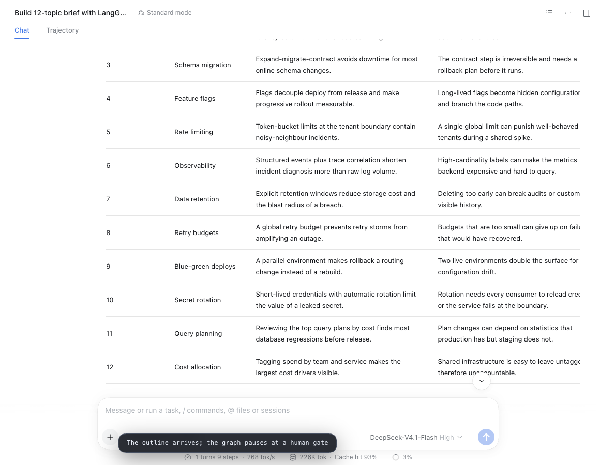

<div align="center">
  

# dsh-langgraph

**Durable, inspectable workflows for DSH.**

Pause for approval. Survive a restart. Fan out over unknown files. See the graph.
No arbitrary model-written JavaScript.

[](https://www.npmjs.com/package/@lzn1998/dsh-langgraph)
[](LICENSE)
[](#reference)
[](docs/DETAIL.md)
[](docs/ECOSYSTEM.md)

[Gallery](gallery/index.html) · [57s real-session demo](media/dsh-langgraph-demo.webm) · [Benchmark](docs/BENCHMARK.md) · [Contract](docs/COMPOSE.md) · [npm](https://www.npmjs.com/package/@lzn1998/dsh-langgraph)

<a href="https://github.com/lznnnnn1998/DSH-LangGraph/blob/main/media/dsh-langgraph-demo.webm"></a>

<sub>A real DSH Web session, not a mock: 12 files → two 12-item maps → outline → human gate → write. 55s, 12 rows, 226K reported tokens.</sub>
</div>

---

## The shape

A composed graph is a contract about seams. The **state** is the ledger that survives a
seam; a **node** is a role that files one result; an **edge** is a handoff; a **map** is one
role repeated over a list; a **gate** is a human signature; a **transform** is the form a
result takes when filed. The compiler is a clerk: JSON in, a LangGraph out, with no model
in the translation.

The ordinary loop remains the default. Reach for a graph only when the work has a real
seam: a fan-out you cannot enumerate, a human decision, or a pause that must survive a
restart. The [benchmark](docs/BENCHMARK.md) is deliberately honest about the tax.

## Install

```sh
dsh plugin --profile <name> add @lzn1998/dsh-langgraph
```

Restart that profile's host. From a local checkout, use
`dsh plugin --profile <name> add /path/to/dsh-langgraph`. Composed graphs need no restart;
the JSON spec is data.

## 60-second quickstart

In a DSH session:

> Read the 12 files under `topics/`, extract one Topic/Claim/Risk row per file, show me the
> outline, and wait for my approval before writing `brief.md`.

The model can register a graph from the profile, or compose one on demand with
`langgraph_compose`. Either way the run is a **durable thread**: the gate returns
`status: "interrupted"`, the human approves, and the same thread resumes. See the
[gallery](gallery/index.html) for six copyable specs and the [video](media/dsh-langgraph-demo.webm).

## What you get

- **A durable thread.** Threads are checkpointed in a DSH storage domain; a run survives a
  turn and a Host restart. Resume with `thread`, replay from a checkpoint, edit a state and
  replay, or run in a DSH background job.
- **A human signature.** `gate` pauses with a question and options; `ask_user_question` is
  available inside graph nodes. The answer goes through `out`; `options` are labels, not
  values.
- **Real fan-out.** `map` sends one body per item, reads `item`/`index`, appends in input
  order, handles the empty list with a sentinel, and caps items/concurrency. The 12-topic
  demo is two maps and a gate.
- **A graph you can see.** Every run is one `langgraph_run` row in **Trajectory**, with
  graph nodes, DSH tool calls, model calls and subagents nested underneath. A Web profile
  gets a **LangGraph** sidebar panel for registered graphs, thread counts and topology.
- **A model-authored contract.** `langgraph_compose` stores an immutable, session-owned
  JSON `GraphSpec` (`lg_adhoc_…`) and runs it with the same threads, interrupts, jobs,
  traces and time travel. The model writes data, never arbitrary JS.
- **Failure is data.** A failed run returns `failedNode`, `failedScc`, `upstream`,
  `downstream`, `pending`, bounded `lastSupersteps`, `error.itemIndex`, `state` and a
  hint. Resume a transient, edit/replay a state error, or `fork` the downstream and
  compose a new graph.
- **DSH-native, not a parallel world.** Graph nodes call the session's own tools through
  `helpers.callTool`; helpers cover `askUser`, `callModel`, `subagent`, `chatModel`,
  `tools([...])` and `createReactAgent`. LangGraph's `BaseStore` runs over a DSH storage
  domain. No DSH or LangGraph source changes.

## Gallery

Six small graphs, each earning its keep at a seam — no node catalogue:

| Graph | The seam | Gate |
|---|---|:---:|
| [Research brief](gallery/specs/research-brief.lg.json) | two maps, extract per file, approve an outline, write | yes |
| [Repo scan](gallery/specs/repo-scan.lg.json) | read source files in parallel, synthesize one review | no |
| [PR review](gallery/specs/pr-review.lg.json) | read the diff, draft, ask before posting | yes |
| [Incident triage](gallery/specs/incident-triage.lg.json) | read logs, classify, ask whether to page | yes |
| [Data extract](gallery/specs/data-extract.lg.json) | one JSON record per file, one JSON array | no |
| [Approval plan](gallery/specs/approval-plan.lg.json) | plan with tools, approve, execute, write | yes |

Open [`gallery/index.html`](gallery/index.html) for the visual gallery, copy a prompt, or
load a spec with `langgraph_compose({ action: "compose", path: "gallery/specs/…" })`.
The gallery is JSON-only; a pull request with a new spec and a validated output is welcome.

## When not to use a graph

Do not start with a graph for a one- or two-step task, a single tool call, or a task a
registered graph already matches. On the 12-topic brief the ordinary loop was
**53s / 124K**; the fine map graph was **55s / 226K**; the coarse agent graph was
**1m38s / 462K**. The graph is a seam tax, not a token discount. The
[benchmark report](docs/BENCHMARK.md) has the full method, numbers and caveats.

## How the model is taught

`langgraph_compose({ action: "describe" })` returns four things, on demand:

1. a prose **guide** — the contract, ledger, seams, roles and forms (built to be read as a
   mentor);
2. a numbered **law** — MUST/MUST NOT rules for state, nodes, edges, maps, gates, failures
   and limits;
3. a vocabulary **reference**;
4. **archetype examples** — `map-gate-write`, `map-extract`, and more.

The compiler is deterministic; no model translates the IR. `validate`/`compose` check tool
visibility and the visible tool's own argument schema, so a wrong `read` argument is caught
before a run, not inside a map. The model can reason from the contract instead of reading
the plugin source.

## Reference

- `langgraph_run` (`graph`, `input`, `thread`, `resume`, `maxSteps`, `run_in_background`;
  omit `graph` to list). A background run returns a DSH job id; read it with `job_output`,
  stop it with `job_kill`.
- `langgraph_threads` (`action`: `list` | `state` | `history` | `edit` | `topology` |
  `delete`). `history` lists checkpoints; `edit` forks a checkpoint with new values.
- `langgraph_compose` (`action`: `describe` | `validate` | `compose` | `list` | `get` |
  `delete` | `fork`). Specs are content-addressed, session-owned, immutable and capped.
- Registry: `graphs/*.js` (and `graphs/*.ts` on Node 24.22+) plus `config.graphs`.
- Helpers: `callTool`, `askUser`, `subagent`, `callModel`, `chatModel`, `tools`, `createReactAgent`, `store`.
- Long-term memory: a real LangGraph `BaseStore` over `langgraph_store`; get/put/delete,
  filtered pagination, namespace listing; vector `query` is rejected rather than faked.
- Trace: `langgraph:node`, `langgraph:tool`, `langgraph:model`, `langgraph:subagent` under
  one `langgraph_run` row; log-only events, never model context.
- Web panel: registered graphs, thread counts, topology; owner-only routes;
  `config.ui: false` disables it.
- Threads are owned by the session and graph that created them; retention defaults to 200
  checkpoints (`0` keeps all) and writes are pruned alongside.
- Limits: 64 nodes, 128 edges, 64 state fields, 256 KiB spec, `maxSteps` 1–200 (default
  25), map items 1–100 (default 50), map concurrency 1–16 (default 8), 64 specs/session.

Read the [compose contract](docs/COMPOSE.md), the [runtime detail](docs/DETAIL.md), the
[context boundary](docs/CONTEXT.md), and the [LangChain ecosystem bridges](docs/ECOSYSTEM.md).

## Trust boundary

The model may compose a graph, but it cannot ship JavaScript. A spec is JSON data:
session-owned, immutable, tool-visible, path-confined and argument-checked. Irreversible
steps belong behind a gate. This is the same DSH sandbox, approval scope and storage; the
plugin adds no privileged execution path.

## Compatibility and tests

DSH 0.2.x, LangGraph 1.7.x, Node 24.9+. The local suite has **166 tests** (`npm test`)
and a `tsc --noEmit --skipLibCheck` check; the benchmark harness is in
[`bench/run.mjs`](bench/run.mjs). The **1.6.0** release is on npm, and the gallery,
benchmark report and 57s demo ship with it. The runtime is unchanged from 1.5.0; 1.6.0
adds the examples, benchmark and documentation.

## Community

This is a small, open plugin built in the open. If it saves you a restart or an approval
mistake, a star helps other DSH users find it. Share a graph on the gallery with a JSON
spec and a validated output; open an issue with a trace or a failing spec. The goal is a
useful default for durable DSH workflows, not a node catalogue.

## License

MIT. See [LICENSE](LICENSE).
